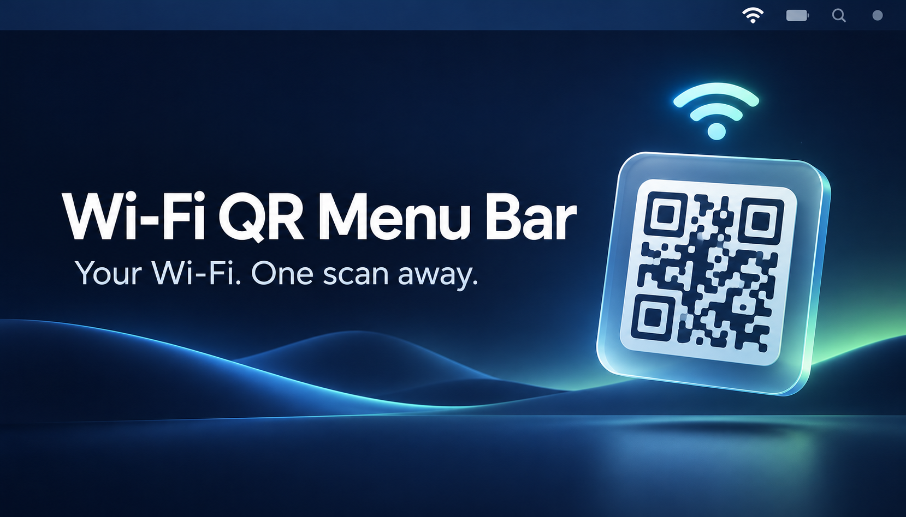

<p align="center">
  
</p>

# Wi-Fi QR Menu Bar

**Share your Mac’s Wi-Fi with a scan.**

WiFi QR is a small native macOS menu bar app that turns your current Wi-Fi network’s saved password into a QR code. Open it, show the code, and let your guests scan it with their phone camera to join.


## Why WiFi QR?

No reading a long password aloud or typing it into someone else’s phone. Keep a tiny utility in your menu bar and bring up your network details when you need them.

- **Your current network:** reads the Wi-Fi network your Mac is connected to.
- **Scan to join:** generates a Wi-Fi QR code locally using Core Image.
- **Readable details:** displays the network name and selectable password alongside the code.
- **Keychain integration:** retrieves the saved password through macOS Security APIs.
- **Permission guidance:** helps you enable Location Services and resumes once access is available.
- **Hidden on close:** clears the displayed network and password from the panel’s state when you close it.

## Get started

Build from source with:

- macOS 14 or later
- Xcode 26 or later
- [XcodeGen](https://github.com/yonaskolb/XcodeGen) 2.45 or later
- [Homebrew](https://brew.sh/) if using the installation command below

```sh
brew install xcodegen
git clone https://github.com/murilloarturo/wifi-qr-menu-bar.git
cd wifi-qr-menu-bar
Scripts/run.sh Release
```

The script generates the Xcode project, builds the app, and opens it. If a copy of **WiFi QR** is already running, it quits that copy first.

To keep the app, copy `.build/DerivedData/Build/Products/Release/WiFi QR.app` to your Applications folder.

> If the build uses Command Line Tools instead of Xcode, select your full Xcode installation. For the default installation path, prefix the build command with `DEVELOPER_DIR=/Applications/Xcode.app/Contents/Developer`.

## Share your Wi-Fi

1. Connect your Mac to the Wi-Fi network you want to share.
2. Click the QR icon in the menu bar, then **Show Password**.
3. Allow the macOS permissions described below when prompted.
4. Ask your guest to scan the code with a phone camera that supports Wi-Fi QR codes, then accept the join prompt.
5. Close the panel to hide the details again.

The banner above is an illustration; scan the code displayed by the running app to join your network.

## Permissions and privacy

**Location access.** macOS restricts access to Wi-Fi network names. WiFi QR requests location permission to identify the network. If access is unavailable, choose **Open Location Settings** and follow the guide. The app continues once the required access is enabled.

**Keychain access.** For a password-protected network, macOS may ask for an administrator’s password before releasing the saved Wi-Fi password. Choose **Always Allow** if you want to authorize future access for that app build. Rebuilding the app can cause macOS to ask again.

Network lookup, password retrieval, and QR generation happen on your Mac. The current source contains no analytics or cloud service integration. The QR code contains the network credentials, so share it with people you want to give access to your network.

## Supported networks

| Network | Behavior |
| --- | --- |
| Personal Wi-Fi with a saved password | Shows the password and a Wi-Fi QR code. Joining depends on the scanning device’s support. |
| Open networks | Generates a QR code without a password. |
| WEP networks | Generates a WEP Wi-Fi QR payload. |
| Enterprise / account-based Wi-Fi | Not supported; these networks do not use a shared password. |

Your Mac must be connected to Wi-Fi. If no saved password can be found, the app displays an explanation instead of a code. A Wi-Fi QR code does not complete captive-portal sign-in.

## Development

The app uses Swift 6, SwiftUI, AppKit, CoreWLAN, Core Location, Security, and Core Image. XcodeGen’s `project.yml` defines the project, including macOS 14 as the deployment target and ad-hoc code signing.

```sh
# Generate the project and build without launching.
Scripts/build.sh Debug

# Build and launch a development copy.
Scripts/run.sh Debug

# Work in Xcode.
xcodegen generate
open WiFiQR.xcodeproj
```

Build logs are written to `.build/build-Debug.log` or `.build/build-Release.log`.

```text
App/          Menu bar lifecycle, panel UI, permissions, network lookup, QR generation
Scripts/      Build and launch helpers
project.yml   XcodeGen project configuration
docs/assets/  README banner and its reusable generation prompt
```

## Contributing

Bug reports and focused pull requests are welcome. Include your macOS version, what happened, and the steps to reproduce it. For Wi-Fi issues, mention the network’s security type without posting passwords or credential-bearing QR codes.

## License

No license has been added yet.
